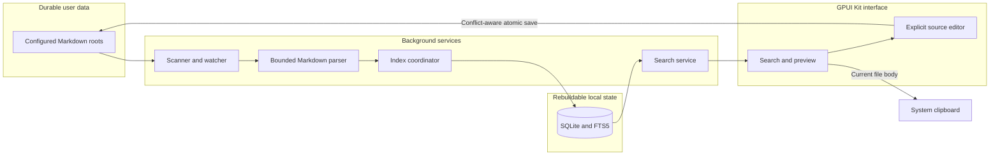

# Architecture

## Overview

The application treats Markdown files as durable user data and SQLite as a
rebuildable local search index.



This separation prevents UI behavior, search technology, and file ownership
from becoming coupled. The boundaries are intentional:

- Markdown files are durable user data; SQLite is derived and disposable.
- Scanning, parsing, search, and file I/O stay outside rendering callbacks.
- Generation tokens prevent obsolete asynchronous work from replacing new UI
  state.
- Every write revalidates roots, exclusions, symlinks, size limits, permissions,
  and external modifications before atomic replacement.

## Major components

### Application configuration

Configuration owns:

- Scan roots, defaulting to the operating system home directory
- Directory and glob exclusions
- Supported Markdown extensions
- Maximum indexed file size
- Global shortcut
- Result limits and other launcher preferences

Configuration is stored in the platform application-data directory. A native
settings window edits the same typed configuration through folder, text, and
boolean controls. It displays the computed defaults and can restore them to the
in-memory draft without writing. It validates the full draft and atomically
replaces the file; the running services continue with their startup
configuration until the user restarts the application. An invalid shortcut falls back independently and is
reported to diagnostics. Malformed
configuration or invalid scan settings stop startup without modifying the file,
so recovery never broadens indexing scope.

Settings opens its macOS folder picker as an asynchronous sheet attached to the
settings window. No blocking native modal loop may run inside a GPUI event
handler: it can reenter background-status callbacks while the app is mutably
borrowed and abort the process. The view retains one picker task, rejects
concurrent picker requests, and keeps its parent window alive until completion.
Selection updates only the current draft; cancellation never restores defaults,
saves, or changes the running scan roots.

### Filesystem scanner

The scanner recursively walks configured roots on a background executor. It
produces candidate paths and basic filesystem metadata without parsing inside
the GPUI render thread.

Responsibilities include:

- Enforcing root boundaries and exclusions
- Avoiding symbolic-link traversal by default
- Filtering extensions case-insensitively
- Skipping oversized or inaccessible files
- Supporting cancellation during shutdown or a replacement scan
- Reporting progress in bounded batches

### Markdown parser

The parser converts one file into an owned document record:

```text
canonical path
optional stable metadata ID
title
tags
Markdown body
modified time
file size
content hash
```

It accepts files with or without YAML frontmatter. A frontmatter parse failure
is isolated to that file and does not stop indexing other documents.

The parser exposes the document body separately from frontmatter so search can
index both metadata and content while clipboard operations copy only the body.

### Index coordinator

The index coordinator is the write boundary for the derived index. It receives
documents from initial scans, reconciliation, filesystem events, and application
note creation/saves.

Its operations are conceptually:

```text
upsert(document)
remove(path)
rename(old_path, new_document)
reconcile(observed_paths)
rebuild()
```

Updates are idempotent because a filesystem watcher may report an application
write more than once. Batch writes use transactions.

### SQLite index

SQLite lives in the platform application-data directory and is not placed in a
scanned Markdown directory. The database enables WAL mode and uses versioned
schema migrations.

The conceptual schema contains:

```text
documents
  id
  canonical_path (unique)
  metadata_id
  title
  tags representation
  body
  modified_at
  file_size
  content_hash
  indexed_at

search_documents (FTS5)
  title
  tags
  body
```

The concrete schema may use an FTS external-content table and triggers or
explicit transactional updates. In either case, metadata and FTS rows must
change atomically.

The database is disposable. Migration or integrity failures can quarantine the
bad database and rebuild it from the configured roots without changing source
files.

### Filesystem synchronization

A recursive watcher observes each configured root after startup. Events are
normalized and debounced before reaching the index coordinator.

Watcher behavior:

- Create or modify: parse and upsert the current file
- Remove: delete the indexed path
- Rename: remove the old path and upsert the new path
- Ambiguous or dropped events: request reconciliation

Watchers are an optimization, not the only consistency mechanism. Startup
reconciliation and manual rebuild repair missed events.

### Search service

The search service owns query parsing, FTS execution, ranking, and result
limits. It returns immutable result values rather than exposing database rows
or connections to the UI.

Title and tag matches receive higher weight than body matches. Queries are
parameterized; user input is never interpolated into SQL.

SQLite work runs outside rendering callbacks. The launcher associates each
asynchronous query with a generation so a slower old query cannot replace newer
results.

### GPUI Kit launcher

The launcher owns retained UI state such as:

- Input state
- Current query generation
- Search results
- Selected result
- Indexing status
- Visible error state

It renders a search input above side-by-side results and read-only preview
panes. Results start unselected. Up, Down, or a click explicitly selects a file;
query changes clear selection and preview. Same-query index refreshes retain
selection only if the same canonical path survives. A live editor pins its
explicitly selected result during same-query refreshes rather than replacing its
buffer when content stops matching or the source disappears. Explicit creation also
selects its new file and temporarily includes it in that result set until a
query change or deletion, independently of indexing latency and result limits.
Hover never selects.
The search input and preview have separate focus handles and key contexts.
Enter focuses only a ready preview. In preview, arrows and paging keys scroll
rather than selecting another search result. Escape first restores search
focus without changing the query/result, then hides from search. A dedicated
Command/Ctrl+Shift+C action copies a whole note only when selection, query,
and ready-preview path agree. Empty/loading/failed previews never activate it.

New sits beside search and opens the existing confirmation dialog. Result rows
reserve space for compact Edit/Copy icon buttons, visible on hover or keyboard
selection. Only selected enabled actions join tab navigation. Edit validates the
captured search generation and canonical path, explicitly selects its row, then
uses the existing editor workflow. Copy shares the keyboard action's selected,
ready-preview, non-editing eligibility and never selects an unselected target.
An outstanding-copy flag suppresses duplicate requests; cancellation and current
completion clear it, while stale completions cannot affect newer work.

Row action handlers stop click propagation. Their wrapper also blocks disabled
clicks from becoming row selection. Result callbacks reject pending/obsolete
searches and modal, Settings, or quit transitions. New Note cancellation restores
the originating search, preview, or editor focus without releasing an active draft.
Result arrows focus search before an old row action becomes invisible. A retained
window focus-lost subscription restores the dialog, active editor, or search when
refreshes remove or disable a focused control, without interfering with Settings,
quit, or a busy native destination sheet.

Application startup registers GPUI Kit's embedded `AllAssets` source before
opening any windows. The full catalog is required because the workspace pencil
icon (`SquarePen`) is absent from the default component-only asset bundle.
Icons remain bundled locally; no runtime downloads or asset folders are needed.

`workspace_ui.rs` supplies fixed dark/blue button palettes and a shared filename,
mode, and full-path-tooltip header. Editor status stays above the source; long
error text scrolls separately so Retry Save stays visible. The footer has bounded
height with wrapping/scrolling rather than pushing content outside the window.
Disabled controls include unavailable reasons in accessible labels and tooltips;
the GPUI base currently omits a native disabled accessibility flag.

A retained preview state distinguishes empty, loading, ready, and failed states.
After a 100 ms selection debounce, a background task reads the current source
through the existing bounded Markdown reader, removes frontmatter, and parses
basic Markdown blocks with `pulldown-cmark`. The complete document is parsed
within the configured file-size limit; there is no preview truncation. Long
blocks, including single huge paragraphs and code fences, are split at UTF-8
boundaries into rows of at most 1,024 source-text characters and 16 newline
characters, plus display-only list markers where applicable. Continuation
markers preserve block styling without repeating list bullets.

A retained GPUI `ListState` uses visible-only measurement, with a 300-pixel
buffer, to render variable-height rows. It is never configured to measure the
whole document on the first frame. A scrollbar allows navigating the complete
preview. Scroll state survives unrelated rerenders and resets when a document
is replaced. Full reading/parsing and memory use still scale with file size;
virtualization bounds per-frame layout, not source I/O or total document memory.

The preview also retains a full rendered plain-text string with byte ranges
for its virtual rows. Selection anchor/cursor offsets refer to that string, not
the mounted elements. Mouse hit testing uses only prepainted text layouts:
rows measured for overdraw do not yet have window bounds. Dragging highlights
visible intersections, while copying uses the complete logical range so skipped
rows are included. An edge-drag timer scrolls and updates the logical cursor;
release, hiding, and document replacement stop it. Select-all/copy bindings live
only in the preview context, leaving search's native editing bindings alone.

The preview model is display-only, never an editing or serialization buffer.
The editor separately retains the full original source, including frontmatter.
HTML is literal text; link labels and image alt text never trigger resource
loading. Rich inline styles and syntax highlighting are not part of this stage.

Replacing the retained task cancels debounced/queued work where possible. An
atomic generation is checked before background loading and before publication;
completion also checks the selected path. An OS read already in progress may
finish but cannot publish obsolete success or failure. Index-driven refreshes
reload an explicitly selected preview so external edits become visible.

The window hides after copy or cancellation. Opening Settings orders only the
launcher window out, preserving its retained query and selection while leaving
the normal settings window visible. A small macOS adapter encapsulates this
per-window AppKit operation because application-level hiding would also hide
Settings. The application process and index services continue running so the
global shortcut can reopen the launcher.

### Source editing and save sessions

`editing.rs` loads bounded complete UTF-8 sources and fingerprints content,
modification time, device/inode, and change time. It revalidates canonical root
containment, exclusions, extensions, and regular-file eligibility on every save.
Descriptor-relative `NOFOLLOW` traversal rejects redirected paths. Opening the
source read/write also respects file permissions, even when its parent permits
replacement.

A save checks the fingerprint, exclusively creates a sibling temporary file,
preserves metadata, writes and synchronizes all bytes, then reopens/rechecks the
source name and parent identity immediately before atomic rename. macOS metadata
copying, including ownership, mode, ACLs, and extended attributes, is encapsulated
in `native/macos-file-metadata`; ownership mismatch fails before publication.
Pre-publication errors leave the source unchanged and attempt temporary cleanup.
Post-publication metadata/folder-sync failures are warnings, not false failed
writes. Conflict checks are optimistic, not a filesystem-wide lock against
uncooperative external writers in the final check/rename interval.

`editor.rs` owns one active `TextareaState`, source baseline, revision counters,
500 ms debounce, visible status/error, and Retry Save. Command/Ctrl+E explicitly
opens eligible files without an app-created ownership restriction. New notes
open in this editor with the cursor after their initial heading. Native text
input owns cursor arrows and ordinary copy/select-all; Enter in search focuses
an already open editor instead of the preview. Escape ends editing with a
best-effort save, shows read-only preview, and focuses search; the next Escape
hides. The app sets a blue theme caret with contrast on both the fixed
dark editor and white dialog inputs; local text styling does not color GPUI carets.
Whole-note copy is disabled while editing until draft-aware copy is implemented.

Only changed content produces snapshots. There is at most one in-flight save
and one coalesced pending snapshot per submitted session, ordered across files.
Revision/path identities prevent stale callbacks from changing another session, and successful writes advance the
baseline before later writes. A shared save gate also orders final native-quit
work and rejects older revisions already superseded by a completed save.

Leaving editing with Escape, switching files, changing the query, hiding, or
opening Settings submits current
changes and immediately drops the active draft. A submitted snapshot owns its
bytes only until completion; failure discards them and retains a reason, not a
retryable detached draft. Unrelated documents remain editable while submissions
are pending, regardless of another file's save failure. Only reopening the same
file waits for its earlier submissions, so its new baseline cannot be stale.
An active-editor failure retains its current input and allows retry of the latest
revision. Canceling the New Note dialog preserves an existing
editor and restores the prior search/editor focus. Successful saves queue the existing serialized index
worker and refresh a selected preview once its editor has closed.

Normal menu/shortcut quit waits for outstanding attempts, then exits even on
failure. The native app-quit observer hands outstanding submissions and the latest
buffer to background-only work within GPUI's shutdown timeout. This path must never reenter GPUI while its
shutdown app borrow is held; the save gate handles an already-running write.
There are no disk draft checkpoints, draft registry, or crash recovery. Temporary
atomic-save files are not recovery state.

### macOS desktop integration

The packaged macOS application runs as an accessory application without a Dock
icon. A template status item in the system menu bar owns five process-level
actions:

- Open and focus the launcher
- Open the settings window
- Request an index rebuild
- Toggle Launch at Login
- Quit the resident process

Menu events are polled on the GPUI foreground executor and reuse the launcher's
existing open, rebuild, and shutdown paths. The status item is retained for the
lifetime of the launcher.

Launch at Login uses `SMAppService.mainApp` and remains unregistered by default.
The menu checkmark reflects Service Management rather than a separate local
preference. Enabling registers the installed main application for subsequent
user logins; disabling unregisters it without terminating the current process.
An approval-required state links to the Login Items section of System Settings.
When the service is enabled, a cold start initializes the resident services and
menu bar item but hides the search window.

A non-blocking application lock in the platform configuration directory is held
for the process lifetime. A second macOS process exits before opening SQLite,
starting watchers, or registering the global shortcut. Finder normally reuses
the already-running application through Launch Services; the lock also protects
direct executable launches.

### Clipboard service

Search results carry a canonical path. Command/Ctrl+Shift+C reads and reparses
that file instead of copying the indexed or preview body. This provides the
latest content if the watcher has not yet processed a recent edit. Normal
Command/Ctrl+C in preview copies only the selected rendered plain text, without
resetting the query or hiding. In search it belongs to the native input.

If the file was removed, became unreadable, or no longer parses, the launcher
reports the error and schedules index repair instead of copying stale content.

## Runtime flows

### First launch

1. Resolve configuration and application-data paths.
2. Acquire the single-instance lock on macOS.
3. Open and migrate SQLite.
4. Open the launcher, create the macOS menu bar item, and start background services.
5. Recursively discover eligible Markdown files.
6. Parse and index documents in bounded transactions.
7. Publish progress to the launcher.
8. Start or confirm filesystem watchers for configured roots.

### Later launch

1. Open and migrate SQLite.
2. Serve searches from the existing index immediately.
3. Compare filesystem metadata with indexed metadata in the background.
4. Parse changed files, add new files, and remove missing paths.
5. Continue with watcher-driven incremental updates.

### Search and copy

1. Input changes and starts a versioned search task.
2. SQLite FTS5 returns bounded, ranked results.
3. The current generation replaces the visible results.
4. Up, Down, or a click explicitly selects and loads a read-only preview.
5. Enter focuses preview; Escape returns focus to search.
6. Command/Ctrl+Shift+C resolves the selected canonical path when preview is ready.
7. The current file is read and parsed outside rendering work.
8. Its Markdown body is written to the clipboard.
9. The query is reset and the launcher hides.

## Concurrency model

GPUI owns presentation state on its foreground executor. Filesystem traversal,
file parsing, hashing, and SQLite work must not run in render callbacks.

Background work communicates through owned messages or results. A completed
batch is applied to retained application state on the foreground executor. No
view observes a partially constructed document.

The SQLite access layer should have a clear ownership policy. A dedicated index
worker with message-based writes is preferred initially; search reads may use a
separate read connection. WAL mode permits reads while the worker commits
updates.

## Extensibility boundaries

Application behavior depends on capabilities rather than concrete storage
inside UI code. Initial boundaries are:

```text
DocumentSource
  scan
  read
  watch

SearchIndex
  upsert
  remove
  search
  rebuild

ClipboardWriter
  write
```

### Root-constrained note creation

`notes.rs` validates single-component filenames, configured extensions, initial
content size, canonical root containment, symlink policy, and all directory/glob
exclusions, including excluded ancestors. It accepts any eligible destination
inside an active scan root, rather than introducing a separate managed folder.
The Documents subfolder suggestion is conditional on this same eligibility.

On Unix, creation walks the canonical root and relative destination through
`rustix` directory handles using `NOFOLLOW`. Missing directories are created
relative to those handles only after confirmation. A same-directory temporary
file is exclusively created, written fully, and synchronized. A hard link
publishes its final name atomically and fails if any file, directory, or symlink
already occupies that name. Temporary cleanup and directory synchronization
follow. Publication failures remove the temporary file; post-publication
cleanup/synchronization failures are warnings, never false creation failures
that would invite a duplicate retry. Non-Unix creation fails closed.

`new_note.rs` owns the modal draft, isolated key context, native macOS folder
sheet, inline errors, and asynchronous creation task. Cancel restores query,
selection, and invoking focus. The modal prevents underlying workspace
shortcuts and activation-triggered hiding. Confirmation disables cancellation,
duplicate submission, and application quit until the write completes. Settings
cannot open over the creation view. As with Settings, the white-input foreground
is scoped by saving/restoring the global theme on modal entry/exit.

The last successful canonical destination is stored atomically in
`note-creation.json` next to configuration, not in the scan settings. Loading is
bounded and malformed/stale preferences are ignored or revalidated. Failure to
save that preference does not turn a successfully created note into an error.

The launcher receives the committed path, clears the search, explicitly selects
the note, and opens its complete-source editor. A temporary result bridges index
latency and the result limit; source deletion or a query change removes it.
Search database failures do not discard an already open newly created note.
`IndexWatchService::request_sync` queues a deduplicated path request for the
existing index worker. Requests and filesystem events use the same serialized
synchronizer, so creation does not introduce another SQLite writer or restart
watchers. Initial-scan completion precedes queued synchronization.

### Deferred workspace operations

Recoverable deletion and draft-aware whole-note copy remain deferred. Markdown
stays authoritative; SQLite never becomes an editing repository or draft store.

## Reliability and security

- Canonical paths are validated against configured roots.
- Symbolic links are not traversed by default.
- New-note writes are root-constrained, directory-handle-anchored, and published
  without overwriting any existing name.
- Edits require explicit entry, preserve full source, and detect external changes
  before atomic replacement; detached-save failures intentionally lose new edits.
- SQL statements use bound parameters.
- Batch sizes and result counts are bounded.
- File size limits prevent accidental indexing of unreasonable documents.
- Parse and permission failures are isolated and observable.
- Index corruption is recoverable because source files remain authoritative.
- Shutdown cancels scans, drains required writes, and closes watchers cleanly.
- No indexing or search operation requires network access.

## Testing strategy

Unit tests cover:

- Configuration defaults and exclusions
- Frontmatter and body parsing
- Path normalization and root boundaries
- FTS query behavior and ranking
- Change classification and debounce logic

Integration tests use temporary directories and databases to cover:

- Initial indexing
- Unchanged-file skipping
- Create, modify, rename, and remove synchronization
- Migration and index rebuild
- Reading the latest body for clipboard confirmation
- Root-constrained atomic note creation, symlink swaps, and concurrent collisions
- Destination preference persistence and explicitly queued incremental indexing
- Source/frontmatter/newline and macOS metadata preservation
- Conflict, permission, size-limit, and directory/symlink race rejection
- Debounce, serialized/coalesced revisions, active retry, and detached failure loss
- Best-effort quit without recovery or stale writes

UI tests cover retained input, keyboard selection, stale-query rejection, empty
results, hide-after-copy behavior, modal isolation, creation errors/retries,
cancel focus restoration, immediate creation-to-editor transition, editor/search
arrow routing, native text copy, index refresh preservation, and switch/hide saves.
Workspace tests also exercise real button clicks, hover visibility and stable
layout, disabled/stale action isolation, tab navigation, copy deduplication,
current-disk copying, modal focus, visible save states, and bounded long errors
with a reachable Retry Save button. Palette tests check enabled-label contrast
in normal, hover, and active states. A binary regression test loads workspace
and standard component SVGs from the registered bundle type, rasterizes them,
and checks for nontransparent pixels; interaction/layout tests alone cannot
establish that icon artwork is available.
Native global shortcuts, focus, clipboard integration, and release packaging require target-platform smoke
tests in addition to automated checks.
